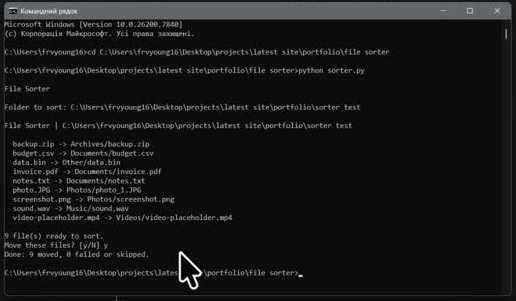

# File Sorter

A Python command-line tool that organises a folder by file type. Built as a small portfolio project focused on file handling and a clear preview-and-confirm workflow.

[](https://github.com/Kredickoa/file-sorter/raw/refs/heads/main/demo/demo.mp4)

[Watch the demo video](https://github.com/Kredickoa/file-sorter/raw/refs/heads/main/demo/demo.mp4)

## Highlights

- Groups files into Photos, Videos, Documents, Music, Archives and Other.
- Previews moves before confirmation; duplicate names receive a numeric suffix.
- Leaves existing subfolders, dotfiles and links untouched.

## Stack

Python 3.12+, pathlib, argparse, shutil and dataclasses. No external packages.

## Run locally

Requires Python 3.12+. Open CMD in the project folder:

```cmd
python sorter.py
```

Paste the folder path, review the plan, then type `y` to sort. To preview directly:

```cmd
python sorter.py "C:\Users\you\Downloads" --dry-run
```

Sorting uses file extensions. Files are copied before their originals are removed, so temporary extra disk space is needed.

## Rights

All rights reserved. Shared for portfolio review; reuse requires prior written permission. See [LICENSE](LICENSE).
